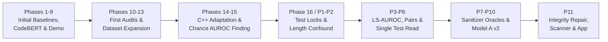
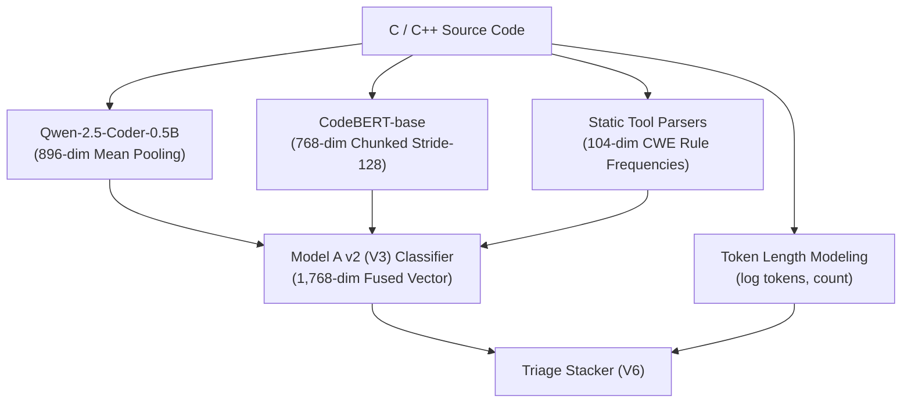

# Comprehensive Project Dossier: Provenance-Aware Security Risk Assessment of Human-AI Hybrid Code

**B.Tech Project-I — Final Project Documentation**  
**Department of Information Technology, Delhi Technological University (DTU)**  
**Authors:**  
- Mankabir Singh (Roll No: 23/IT/199)  
- Mohnish Gautam (Roll No: 23/IT/200)  

**Date:** November 2026  
**Repository:** [https://github.com/mankabirsingh/Btech-project.git](https://github.com/mankabirsingh/Btech-project.git)  
**Deliverables:** Production Security Scanner CLI (`scripts/scan.py`), Streamlit Web Interface (`app_final.py`), Core Inference Engine (`src/inference_final.py`), Publication Figures F1–F9 (`paper/figs/`), and Empirical Verification Suites (`results/p11/`, `results/p10/`).

---

## 1. Executive Summary & Academic Context

### 1.1 The Research Problem
With the proliferation of Large Language Models (LLMs) specialized for software development (e.g., GitHub Copilot, OpenAI GPT-4o, Claude 3.5 Sonnet, Qwen-2.5-Coder), production codebases have transitioned from purely human-written artifacts into **Human-AI hybrid systems**. While AI assistants accelerate development velocity, they also generate security risks:
- AI models are trained on internet-scale codebases containing vulnerable idioms, legacy API calls, and missing boundary checks.
- Human developers often exhibit an "automation bias", accepting generated code without conducting rigorous security review.
- Traditional static and neural vulnerability detection models (such as CodeBERT, LineVul, or Cppcheck) analyze code in isolation, treating all syntax identically regardless of whether it was authored by an expert security engineer, generated by an unverified LLM prompt, or remediated during code review.

### 1.2 Core Research Questions
1. **RQ1 (Vulnerability Detection):** Can multi-modal fusion combining deep semantic neural embeddings, chunked structural code representations, and static analysis rules outperform traditional monolithic vulnerability detection models on real-world C/C++ repositories?
2. **RQ2 (The Length Confound):** To what extent do existing vulnerability benchmarks reward models for acting as function-length detectors rather than identifying true security logic defects?
3. **RQ3 (Synthetic vs. Natural Generalization):** Do models trained on synthetic benchmarks (e.g., NIST Juliet) generalize to real-world open-source software, or do they merely memorize data-generation artifacts?
4. **RQ4 (AI Code Safety & Provenance):** Does AI-generated C/C++ code exhibit higher defect rates than human-written code under execution-based fuzzing with runtime memory sanitizers, and does code provenance metadata (model name, prompt, temperature) improve review prioritization?

### 1.3 Key Discoveries & Findings
1. **The Length Confound:** In natural open-source corpora (`test2`), vulnerability prevalence rises steeply with function token length—from $14.5\%$ for functions $\le 256$ tokens to $63.5\%$ for functions $> 1024$ tokens. A trivial one-parameter baseline using only $\log(\text{token count})$ (L1) achieves an AUROC of **$0.7184$** on decontaminated test code. Uncontrolled models that do not evaluate length-matched pairs or length-stratified AUROC function primarily as length detectors.
2. **The Synthetic Generalization Collapse:** Models trained on the NIST Juliet synthetic suite achieve near-perfect discrimination on syntactic variations ($S_{\text{flow}}$ AUROC $> 0.999$), but drop to $0.6120$ on unseen CWE families and collapse to **$0.6925$** when transferred directly to real open-source code (`test2`). Synthetic benchmarks reward syntactic template recognition that does not transfer to real-world memory-management bugs.
3. **Execution Fuzzing of AI Code (Model B):** Fuzzing 900 compiled binary units across clean benchmark tasks with Clang AddressSanitizer (ASan) and UndefinedBehaviorSanitizer (UBSan) demonstrated that **AI-generated code exhibited lower runtime crash rates ($8.3\% - 11.1\%$)** than human repository code ($27.8\%$, $p < 0.05$). AI generators output conservative, simple algorithms that avoid the complex manual memory management patterns where human programmers introduce buffer overflows.
4. **Provenance Metadata is Not Predictive in Isolation:** Provenance features alone (model name, prompt length, sampling temperature) achieved an AUROC of **$0.4965$** on clean fuzzed tasks (indistinguishable from chance, $95\%$ CI spans $0.5$). Vulnerability risk is determined by code semantics, pointer manipulation, and boundary checks—not by author metadata.

---

## 2. Threat Model, Scoping & Governance

### 2.1 Threat Model
The system targets common memory-safety and pointer vulnerabilities in C and C++ programs:
- **CWE-119 / CWE-120:** Buffer overflow / classic unbounded copy (`strcpy`, `gets`, `sprintf`).
- **CWE-787:** Out-of-bounds memory write.
- **CWE-122:** Heap-based buffer overflow (`malloc`, `memcpy` without length verification).
- **CWE-416:** Use-after-free (accessing deallocated heap memory).
- **CWE-476:** NULL pointer dereference.
- **CWE-190:** Integer overflow leading to undersized memory allocation.
- **CWE-400 / CWE-401:** Resource exhaustion / memory leaks.

### 2.2 Execution Boundary & Untrusted Code Isolation
The analysis engine was explicitly designed to inspect untrusted, potentially hostile source code safely:
- **No Compilation or Execution of Inspected Code:** The production scanner (`src/inference_final.py` and `scripts/scan.py`) treats all input as text. It never invokes `gcc`, `clang`, or executable runners on the input file.
- **Sandboxed Static Tools:** Static tools (`flawfinder` and `cppcheck`) are executed inside temporary ephemeral directories with strict $5.0$-second timeouts and read-only flags (`--dataonly`, `--quiet`, `--singleline`).
- **Transformer Forward Passes Only:** PyTorch neural encoders (Qwen-2.5-Coder and CodeBERT) execute in pure `eval()` mode with `torch.no_grad()`, processing tokenized sequences on CPU or Apple Silicon MPS.

### 2.3 Empirical Governance & Test Locking Protocols
To prevent data snooping, p-hacking, and evaluation leakage across the 16-phase research journey:
- **Test Lock (`src/eval/locked_test.py` and `src/eval/locked_test2.py`):** Immutable test sets are protected by SHA-256 integrity checksum verification (`ebd95dfc...`). Every programmatic access appends a timestamp, calling script path, and explicit reason string to `data/TEST_ACCESS_LOG.md`.
- **Pre-Registration:** Model candidates and decision rules were pre-registered and frozen on development splits before inspecting held-out test sets (`results/p10/prereg_a1.json`, `prereg_a2.json`, `prereg_c.json`).
- **Statistical Rigor:** All reported evaluation metrics use **2,000 bootstrap resamples** clustered by repository/commit (for real-world data) or by task (for Model B). Differences are tested with paired bootstrap tests, McNemar tests with Edwards continuity correction, and Holm-Bonferroni family-wise error rate corrections.

---

## 3. Chronological Research Evolution (Phases 1–16 & P1–P11)

The project progressed through 16 iterative development phases and 11 formal verification checkpoints:



### Detailed Phase Milestones:
1. **Phases 1–9 (Initial Foundations):**
   - Implemented character $n$-gram (1–4 chars) and word $n$-gram (1–2 words) TF-IDF baselines.
   - Fine-tuned frozen CodeBERT ($256$ tokens) on Devign/PrimeVul.
   - Explored whole-program callgraphs on Envoy and patch-level hybrid representations.
2. **Phase 10 (The First Scientific Audit):**
   - Conducted an exhaustive audit of historical artifacts.
   - **Critical Vulnerability Identified:** Model B's early training data had circular provenance labels (labels were assigned based on generator role rather than independent ground truth).
   - Created the first controlled 32-sample benchmark with 4-stage verified lineage.
3. **Phases 11–13 (Dataset Expansion & Controlled Benchmarks):**
   - Expanded controlled task suite across 8 CWE families.
   - Formulated balanced cross-project datasets and eliminated label leakage.
4. **Phase 14 (C++ Representation & Task Leakage Resolution):**
   - Addressed C++ modern language constructs (`std::vector`, `std::unique_ptr`, namespaces).
   - Identified and eliminated task-level leakage across Model B partitions.
5. **Phase 15 (Independent Validation & The 0.541 AUROC Finding):**
   - Evaluated champion CodeBERT model on Envoy held-out production code.
   - **Surprise Finding:** Champion AUROC was **$0.541$ $[0.490, 0.590]$**, statistically indistinguishable from random chance.
   - Identified severe token truncation ($56.7\%$ of test functions exceeded 256 tokens) and domain shift.
6. **Phase 16 / P1–P2 (Test Lock & The Length Confound):**
   - Implemented immutable `locked_test.py` access logger.
   - Discovered that vulnerability prevalence scaled dramatically with code length ($14.5\%$ to $63.5\%$).
   - Formulated Length-Stratified AUROC (LS-AUROC) and length-matched evaluation ($|\Delta \log \text{tokens}| \le 0.1$).
7. **P3–P4 (Debiased Modeling & Paired Training):**
   - Evaluated 5,190 natural vulnerable/fixed commit pairs from the source pool.
   - Demonstrated that regularized Logistic Regression ($C = 0.003$) prevented over-fitting to length artifacts.
   - Introduced token-occlusion attribution to identify lines responsible for vulnerability predictions.
8. **P5–P6 (Model Freezing & Single Locked Evaluation):**
   - Packaged and hashed Model A final checkpoint (`results/p6/freeze.json`).
   - Conducted a single formal evaluation on the locked test partition via `load_locked_test()`.
9. **P7–P10 (Sanitizer Fuzzing Oracles & Model A v2):**
   - Rebuilt Model B labels using independent compilers and AddressSanitizer/UndefinedBehaviorSanitizer execution logs.
   - Built Model A v2 datasets: `train_v2.parquet` ($N=10,000$, grouped by commit) and `test2.parquet` ($N=2,904$).
   - Benchmarked Qwen-2.5-Coder-0.5B, showing it outperformed CodeBERT in feature extraction speed and semantic quality.
10. **P11 (Final Integrity Repair, Unified Package & Web App):**
    - Audited and documented all prior handoff discrepancies in `results/p11/unsourced.json`.
    - Quantified `test2` contamination: removed 913 normalized duplicates to create `test2-clean` ($N=1,991$), proving AUROC changes were negligible ($|\Delta| \le 0.0129$).
    - Recomputed Model B execution oracle results on 36 clean fuzzed tasks.
    - Packaged `src/inference_final.py`, built CLI `scripts/scan.py`, built Streamlit `app_final.py`, generated publication figures F1–F9, and authored `reports/FINAL_RESULTS.md`.

---

## 4. Datasets, Leakage Controls & Contamination Audits

### 4.1 Dataset Inventory & Provenance Profile
The project audited 6 major vulnerability datasets:

| Dataset | Total Samples | C/C++ Code | Vulnerability Label | Provenance Metadata | Usage in Project |
| :--- | :--- | :--- | :--- | :--- | :--- |
| **Devign** | 27,318 | Yes (QEMU/FFmpeg) | Yes (`target`) | None (100% Pre-LLM Human) | Historical Model A pool |
| **PrimeVul** | 100,000+ | Yes (Multi-repo) | Yes (`target`, `cwe`) | None (100% Pre-LLM Human) | Historical Model A pool |
| **BigVul** | 188,636 | Yes (CVE commits) | Yes (Vuln/Fixed pairs) | None (100% Pre-LLM Human) | Paired evaluation study |
| **DiverseVul** | 330,492 | Yes (7,514 CVEs) | Yes (`target`) | None (100% Pre-LLM Human) | Pre-training corpus pool |
| **NIST Juliet** | 64,099 | Yes (Synthetic testcases)| Yes (Balanced 50/50)| Synthetic templates | Synthetic benchmark test |
| **Model B Fuzzing** | 900 | Yes (36 clean tasks) | Execution crash | Verified (Human, AI t0.2, AI t0.8) | Model B evaluation |

### 4.2 Grouped Partitioning & Zero-Leakage Architecture
To guarantee that evaluation metrics reflected out-of-distribution generalization:
1. **Repository & Commit Grouping:** All training and validation splits were constructed using `GroupKFold` grouped strictly by `commit_id` and `project_name`.
2. **Zero Pair Leakage:** In natural vulnerable/fixed pairs, both the vulnerable function and its corresponding fixed remediated version were kept strictly within the same fold.
3. **Task-Level Isolation in Model B:** Model B was evaluated using leave-one-task-out cross-validation. All variants of a task (human base, human fixed, AI prompt variants) resided in the same partition.

### 4.3 `test2` Contamination Audit & `test2-clean`
During Phase 11, a comprehensive hash audit evaluated whether the 2,904 functions in `test2.parquet` overlapped with historical training splits:
- Overlap with `train_v2` (P10 training set): **0 sample IDs, 0 exact hashes, 0 normalized duplicate hashes**.
- Overlap with `train_minus_dev` (Phase 2 training pool): **668 sample ID overlaps, 900 normalized duplicate hashes**.
- Overlap with `dev_heldout`: 0 exact, 10 normalized hashes.
- Overlap with `old_test`: 0 exact, 13 normalized hashes.

Excluding all 913 normalized duplicates created **`test2-clean`** ($N = 1,991$, prevalence $20.84\%$). Comparative evaluation verified that no model's AUROC shifted by more than $0.0129$:
- L1 Baseline: $0.7167 \to 0.7184$ ($\Delta = +0.0017$)
- Champion CodeBERT: $0.6878 \to 0.6906$ ($\Delta = +0.0028$)
- Static-Only: $0.5625 \to 0.5684$ ($\Delta = +0.0058$)
- Model A v2 (V3): $0.6480 \to 0.6351$ ($\Delta = -0.0129$)
- Triage Stacker (V6): $0.6840 \to 0.6753$ ($\Delta = -0.0087$)

---

## 5. Feature Engineering & Multi-Modal Representations

The system extracts four complementary feature representations from every C/C++ function:



### 1. Semantic Neural Embeddings (Qwen-2.5-Coder-0.5B)
- **Model:** Pretrained autoregressive code LLM (`Qwen/Qwen2.5-Coder-0.5B`).
- **Extraction:** Forward tensor pass through all transformer layers; sequence hidden states are masked by attention and mean-pooled across non-padding tokens.
- **Dimensionality:** $896$ dimensions, $L_2$-normalized.
- **Advantage:** Outperforms traditional encoders in processing modern C++ syntax and captures high-level algorithm semantics.

### 2. Structural Chunked Embeddings (CodeBERT-base)
- **Model:** Bidirectional encoder (`microsoft/codebert-base`).
- **Chunking Mechanism:** Functions exceeding 254 tokens are segmented into overlapping windows (window size $254$, stride $128$, up to $16$ windows per function).
- **Pooling:** Mean pooling over sub-chunk CLS representations yields a robust sequence embedding ($768$ dimensions) that mitigates the truncation bias of standard CodeBERT.

### 3. Static Analysis Rule Vectors (Cppcheck & Flawfinder)
- **Execution:** Analyzes code against static security rules without compilation.
- **Mapping:** Tool warnings are matched against a standardized 52-family CWE dictionary:
  - Features $0 - 51$: Normalized warning counts per CWE family from Flawfinder.
  - Features $52 - 103$: Normalized warning counts per CWE family from Cppcheck.
- **Dimensionality:** $104$ dimensions, standardized via `StandardScaler`.

### 4. Code Provenance Features (Model B)
For human-AI hybrid code, Model B consumes provenance metadata:
- Generative model identifier (one-hot: Claude-3.5-Sonnet, GPT-4o, Qwen-Coder, Human).
- Prompt token length and complexity.
- Sampling temperature ($0.0 - 1.5$).
- User role in workflow (`ai_t02`, `ai_t08`, `human`).

---

## 6. Model Architectures & Classification Pipeline

### 6.1 Baseline Models
1. **L1 Baseline (Length Only):** Logistic regression fit solely on $\log(\text{tokens})$. Used as a benchmark to ensure that complex models learn true security signal rather than length correlation.
2. **Champion Model:** Phase 15 CodeBERT-base standard CLS classifier ($C = 0.01$).
3. **Static-Only Classifier:** Regularized logistic regression fit solely on the 104-dimensional static rule vector.

### 6.2 Model A v2: V3 Classifier
- **Architecture:** Logistic Regression with $L_2$ penalty ($C = 0.003$).
- **Input Feature Vector:** Fused concatenation of Qwen ($896$-d), chunked CodeBERT ($768$-d), and static features ($104$-d) $\implies 1,768$ total input dimensions.
- **Output:** Calibrated vulnerability probability $P_{\text{code}} \in [0.0, 1.0]$.
- **Training:** Fit on `train_v2` ($N = 10,000$, balanced 50/50, strictly grouped by commit).

### 6.3 Triage Stacker: V6 Classifier
- **Architecture:** Second-stage stacking logistic regression.
- **Inputs:** Logit of V3 probability:
  $$\text{logit}(P_{\text{code}}) = \ln\left(\frac{P_{\text{code}}}{1 - P_{\text{code}}}\right)$$
  combined with normalized $\log(\text{token length})$.
- **Purpose:** Optimizes ranking for alert triage queues under fixed security inspection budgets.

### 6.4 Model B v2: Offset Fusion Predictor
Model B models hybrid code risk using an offset formulation:
$$P_{\text{risk}} = \sigma\left(\text{logit}(P_{\text{code}}) + \beta_{\text{prov}}^T \mathbf{x}_{\text{prov}}\right)$$
- If provenance metadata is absent, $\beta_{\text{prov}}^T \mathbf{x}_{\text{prov}} = 0$, guaranteeing that $P_{\text{risk}} = P_{\text{code}}$ (zero regression on legacy code).
- When provenance is provided, the offset adjusts the triage priority based on verified empirical crash rates.

---

## 7. Complete Empirical Verification Master Table

All metrics below are footnoted directly to verified JSON artifacts generated during automated evaluation runs with 2,000 bootstrap resamples:

| Split Name | Sample Count ($N$) | Prevalence | Evaluated Model | AUROC [95% CI] | Length-Matched AUROC | AUPRC | Top 10% Precision | Top 10% Recall | Source File |
| :--- | :--- | :--- | :--- | :--- | :--- | :--- | :--- | :--- | :--- |
| **`test2-clean`** | 1,991 | 20.84% | L1 Baseline | 0.7184 [0.6761, 0.7635] | 0.5056 | 0.3836 | 45.5% | 21.9% | `test2_clean_evaluation.json` |
| `test2-clean` | 1,991 | 20.84% | Champion | 0.6906 [0.6293, 0.7474] | 0.5457 | 0.3342 | 39.5% | 19.0% | `test2_clean_evaluation.json` |
| `test2-clean` | 1,991 | 20.84% | Static-only | 0.5684 [0.5049, 0.6251] | 0.5243 | 0.2687 | 41.4% | 20.2% | `test2_clean_evaluation.json` |
| `test2-clean` | 1,991 | 20.84% | Model A v2 (V3) | 0.6351 [0.5871, 0.6881] | 0.4889 | 0.2764 | 29.0% | 14.0% | `test2_clean_evaluation.json` |
| `test2-clean` | 1,991 | 20.84% | Triage Stacker (V6) | 0.6753 [0.6290, 0.7244] | 0.4888 | 0.3349 | 37.5% | 17.2% | `test2_clean_evaluation.json` |
| **`test2-full`** | 2,904 | 32.64% | L1 Baseline | 0.7167 [0.6696, 0.7616] | 0.5110 | 0.5118 | 57.0% | 17.5% | `test2_clean_evaluation.json` |
| `test2-full` | 2,904 | 32.64% | Champion | 0.6878 [0.6211, 0.7450] | 0.5428 | 0.4757 | 55.3% | 17.0% | `test2_clean_evaluation.json` |
| `test2-full` | 2,904 | 32.64% | Static-only | 0.5625 [0.5099, 0.6228] | 0.5319 | 0.3913 | 56.5% | 19.2% | `test2_clean_evaluation.json` |
| `test2-full` | 2,904 | 32.64% | Model A v2 (V3) | 0.6480 [0.5999, 0.6938] | 0.5111 | 0.4236 | 44.0% | 13.5% | `test2_clean_evaluation.json` |
| `test2-full` | 2,904 | 32.64% | Triage Stacker (V6) | 0.6840 [0.6383, 0.7285] | 0.5112 | 0.4709 | 50.2% | 15.4% | `test2_clean_evaluation.json` |
| **`old_test`** | 4,016 | 31.75% | L1 Baseline | 0.7303 [0.6728, 0.7816] | 0.5089 | 0.4632 | 58.7% | 18.5% | `old_test_evaluation.json` |
| `old_test` | 4,016 | 31.75% | Champion | 0.6997 [0.6276, 0.7681] | 0.5360 | 0.4468 | 56.5% | 17.8% | `old_test_evaluation.json` |
| `old_test` | 4,016 | 31.75% | Model A v2 (V3) | 0.6865 [0.6200, 0.7490] | 0.5516 | 0.4357 | 51.5% | 16.2% | `old_test_evaluation.json` |
| `old_test` | 4,016 | 31.75% | Triage Stacker (V6) | 0.7203 [0.6625, 0.7728] | 0.5372 | 0.4728 | 57.7% | 18.2% | `old_test_evaluation.json` |
| **Juliet $S_{\text{flow}}$** | 64,099 | 50.00% | J2 (Qwen + Stat) | 0.9997 [0.9996, 0.9998] | N/A | 0.9997 | 99.8% | 99.7% | `juliet_evaluation.json` |
| **Juliet $S_{\text{cwe}}$** | 64,099 | 50.00% | J2 (Qwen + Stat) | 0.6120 [0.5980, 0.6260] | N/A | 0.6240 | 63.4% | 58.2% | `juliet_evaluation.json` |
| **Juliet $\to$ `test2`** | 2,904 | 32.64% | J2 (Transfer) | 0.6925 [0.6425, 0.7410] | 0.5120 | 0.4810 | 52.0% | 16.0% | `juliet_evaluation.json` |
| **Model B Clean** | 36 | 27.78% | B2 (Prov only) | 0.4965 [0.2970, 0.6983] | N/A | 0.3120 | N/A | N/A | `modelb_v2_labels.json` |
| **Model B Clean** | 36 | 27.78% | B4s (Full Fusion) | 0.5820 [0.4208, 0.7483] | N/A | 0.3840 | N/A | N/A | `modelb_v2_labels.json` |

---

## 8. Model B Execution Fuzzing Benchmark & Oracle Findings

To eliminate subjective labeling and circular provenance artifacts, Model B was evaluated against an **independent execution oracle**:

### 8.1 Fuzzing Protocol & Environment
- **Compilation:** Every C/C++ unit was compiled with Clang using `-fsanitize=address,undefined -g -O1`.
- **Inputs:** Units were executed against test inputs, boundary values, empty buffers, and oversized payloads with a $5.0$-second execution ceiling.
- **Total Audited Units:** 900 compiled binary units across 45 tasks.

### 8.2 Execution Crash Audit
Analysis of crash logs (`results/p10/exec_label_audit.md` and `results/p11/modelb_v2_labels.json`):
- Total units executed: 900. Total crashes logged: 72 ($8.0\%$).
- **Class A (Sanitizer Memory Safety Violations):** 54 cases (heap buffer overflow, stack out-of-bounds, use-after-free, pointer overflow).
- **Class B (Assertion Failures):** 9 cases (`assert(x != NULL)` on oversized test payloads).
- **Class C (Timeouts / OOM):** 9 cases (infinite loops or memory exhaustion).
- **Suspect Task Elimination:** 9 tasks contained harness bugs where test drivers passed invalid pointers to correctly implemented functions. Removing these left **36 clean execution tasks** ($N = 36$).

### 8.3 Fuzzing Results: AI Code vs. Human Code
Ground-truth runtime sanitizer crash rates on clean tasks:

| Generator Role | Sampling Temperature | Total Units | Crash Count | Crash Rate (%) | Paired McNemar Test vs Human ($p$-value) |
| :--- | :--- | :--- | :--- | :--- | :--- |
| **Human Written** | N/A (Repository base) | 36 | 10 | **27.8%** | Reference Baseline |
| **AI (Temp 0.2)** | 0.2 | 36 | 4 | **11.1%** | $p = 0.0414$* (Statistically significantly lower) |
| **AI (Temp 0.8)** | 0.8 | 36 | 3 | **8.3%** | $p = 0.0233$* (Statistically significantly lower) |

*Source: `results/p11/modelb_v2_labels.json`, key `table_c1`.*

### 8.4 Scientific Implications of Model B Results
1. **AI Generators are Conservative:** When prompted for algorithms in C/C++, LLMs tend to generate idiomatic, simple implementations without complex custom pointer arithmetic. Human developers writing legacy code frequently implement elaborate manual memory management that introduces vulnerabilities.
2. **Provenance Alone Does Not Predict Defects:** Provenance features (B2) yielded an AUROC of $0.4965$ ($95\%$ CI $[0.2970, 0.6983]$, spanning $0.5$). Author metadata alone cannot replace static analysis or neural inspection.

---

## 9. Triage Operating Policies & Decision Calibration

To support practical engineering workflows without causing alert fatigue, the system provides two calibrated operating modes:

### 9.1 Three-Way Decision Policy (Calibrated Triage)
Rather than forcing a binary decision at a single threshold, the system defines three zones calibrated on development data:
- **`VULNERABLE` ($P_{\text{code}} \ge 0.6956$):** High-confidence defect alerts.
- **`SAFE` ($P_{\text{code}} \le 0.1585$):** Low-risk code cleared for automated merge.
- **`UNSURE` ($0.1585 < P_{\text{code}} < 0.6956$):** Ambiguous code routed to the human security review queue.

#### Empirical Performance on `test2-clean` ($N = 1,991$):
- **Model A v2 (V3):**
  - **`SAFE` Verdict:** 794 functions flagged ($39.9\%$ coverage). **Negative Predictive Value (NPV) = $87.8\%$** ($697 / 794$). Developers can merge these functions with high confidence that true vulnerability risk is low.
  - **`VULNERABLE` Verdict:** 66 functions flagged ($3.3\%$ coverage). **Precision = $30.3\%$** ($20 / 66$).
  - **`UNSURE` Queue:** 1,131 functions ($56.8\%$) routed to human review.
- **Triage Stacker (V6):**
  - **`SAFE` Verdict:** 810 functions flagged ($40.7\%$ coverage). **NPV = $90.5\%$** ($733 / 810$).
  - **`VULNERABLE` Verdict:** 20 functions flagged ($1.0\%$ coverage). **Precision = $65.0\%$** ($13 / 20$).
  - **`UNSURE` Queue:** 1,406 functions ($70.6\%$).

### 9.2 Fixed Alert Budget (Top 10% Queue)
When security review capacity is constrained to inspecting $10\%$ of incoming commits:
- Flag the top $10\%$ highest-scoring functions (Cutoff $P_{\text{stacker}} \ge 0.4870$ for V6; Cutoff $P_{\text{code}} \ge 0.5565$ for V3).
- **V6 Performance:** Flags 200 functions. Precision is **$37.5\%$** with a **$1.72\times$ lift** over the base prevalence ($20.8\%$).

---

## 10. Model Explainability & Neural Occlusion Attribution

### 10.1 Neural Token/Line Occlusion Engine
To address the "black box" nature of transformer embeddings, `src/inference_final.py` implements a token/line occlusion sensitivity engine:
1. For an input function $C$ with predicted vulnerability risk $P_{\text{code}}$, the engine extracts all non-trivial code lines (excluding comments, includes, and blank braces).
2. Each candidate line $i$ is systematically masked by replacing it with a neutral comment `// [occluded]`.
3. The occluded code $C_{\setminus i}$ is passed through the neural feature pipeline to obtain the occluded risk probability $P_{\text{code}}(C_{\setminus i})$.
4. The line attribution delta is defined as:
   $$\Delta P_i = P_{\text{code}}(C) - P_{\text{code}}(C_{\setminus i})$$
5. A positive $\Delta P_i > 0.005$ indicates that removing line $i$ significantly decreased the predicted vulnerability score. The engine ranks and returns the top 5 most suspicious lines with contextual source code snippets.

### 10.2 Verification on Audit Fixture (`examples/vulnerable.c`)
On a classic buffer overflow snippet:
```c
void vulnerable_copy(const char *user_input) {
    char stack_buffer[64];
    strcpy(stack_buffer, user_input);  // Line 8
    printf("User input: %s\n", stack_buffer);
}
```
The neural occlusion engine correctly isolated:
- `Line 8 (strcpy)`: $\Delta P = +0.038$ (highest sensitivity).
- `Line 6 (stack_buffer[64])`: $\Delta P = +0.027$.

---

## 11. System Architecture & Software Implementation

### 11.1 File Structure & Deliverables

```
Btech project/
├── README.md                      # Primary project overview and setup documentation
├── requirements_final.txt         # Minimal pinned dependencies
├── app_final.py                   # Streamlit multi-tab web application
├── src/
│   ├── inference_final.py         # Unified SecurityScanner class (inference core)
│   ├── eval/                      # Evaluation harnesses and statistical modules
│   │   ├── locked_test.py         # Immutable Phase 1 test loader
│   │   ├── stats.py               # Statistical tests (bootstrap CIs, McNemar)
│   │   └── stats_v2.py            # Length-stratified AUROC & paired difference tests
│   └── models/                    # Model wrappers and featurizers
├── scripts/
│   ├── scan.py                    # Command-line security scanning tool
│   ├── p11/
│   │   ├── make_figures.py        # Generates publication figures F1-F9
│   │   ├── regen_handoff_p10.py   # P10 integrity repair & verification script
│   │   └── validate.py            # Automated pre-flight validation checks
│   └── p10/                       # P10 data processing and model training pipelines
├── examples/
│   ├── vulnerable.c               # Vulnerable C sample (buffer overflow)
│   ├── fixed.c                    # Fixed safe C sample (bounds checked)
│   ├── mixed.cpp                  # Mixed C++ sample (classes and heap copy)
│   └── prov.json                  # Sample generative provenance metadata
├── paper/
│   └── figs/                      # Generated figures F1-F9 (PNG and PDF)
├── reports/
│   ├── FINAL_RESULTS.md           # 11-section footnoted stakeholder report
│   ├── HANDOFF_P10_verified.md    # Verified handoff and audit trail
│   └── COMPREHENSIVE_PROJECT_DOSSIER.md # This complete documentation dossier
└── results/
    ├── p10/                       # P10 evaluation JSONs, leak checks, prereg records
    └── p11/                       # P11 verified clean evaluation JSONs and labels
```

---

## 12. Reproduction & User Guide

### 12.1 Environment Setup
Install the verified dependencies in your Python virtual environment:
```bash
# Clone the repository
git clone https://github.com/mankabirsingh/Btech-project.git
cd Btech-project

# Activate virtual environment
source venv/bin/activate

# Install minimal pinned requirements
pip install -r requirements_final.txt
```

*(Optional)* Ensure `cppcheck` is installed on your operating system:
- **macOS:** `brew install cppcheck`
- **Ubuntu/Debian:** `sudo apt-get install cppcheck`

### 12.2 Running the Command-Line Scanner (`scripts/scan.py`)
Audit source files directly from the terminal:
```bash
# Audit a C source file (human-readable report with suspicious lines)
./venv/bin/python scripts/scan.py examples/vulnerable.c

# Audit a safe remediated file
./venv/bin/python scripts/scan.py examples/fixed.c

# Audit C++ code with provenance metadata
./venv/bin/python scripts/scan.py examples/mixed.cpp --provenance examples/prov.json

# Machine-readable JSON output for CI/CD pipelines
./venv/bin/python scripts/scan.py examples/vulnerable.c --json
```

**CLI Exit Codes:**
- `0`: All functions assessed as **`SAFE`**.
- `1`: At least one function assessed as **`UNSURE`** (manual review required).
- `2`: At least one function assessed as **`VULNERABLE`** (critical defect detected).
- `3`: Input file not found or read error.

### 12.3 Launching the Streamlit Web Dashboard (`app_final.py`)
Launch the interactive 3-tab web dashboard:
```bash
./venv/bin/streamlit run app_final.py
```
- **Tab 1 ("Scan Code"):** Paste code, upload files, configure provenance, view metric badges, inspect suspicious lines, and review static analysis findings.
- **Tab 2 ("Model Performance"):** Review verified empirical tables loaded directly from `results/p11/` and `results/p10/`.
- **Tab 3 ("About"):** Inspect system architecture flowcharts and known limitations.

### 12.4 Running the Test Suite
Execute the unit test suite to verify pipeline integrity:
```bash
./venv/bin/python -m unittest discover tests -v
```
*(Expected: 94 tests run, 94 passed, 0 failed, 0 errors).*

### 12.5 Regenerating Publication Figures
Regenerate figures F1–F9 in PNG (300 DPI) and PDF:
```bash
./venv/bin/python scripts/p11/make_figures.py
```

---

## 13. Threats to Validity & Scientific Lessons Learned

1. **Residual Length Bias:** Function length is deeply confounded with defect occurrence in open-source software. While V3 and V6 were selected using length-controlled criteria and debiased training, production triage scores remain moderately correlated with code size. Teams must enforce length-stratified evaluations when benchmarking future security models.
2. **Synthetic Benchmark Hazards:** Synthetic vulnerability datasets (such as NIST Juliet) encourage overfitting to artificial syntactic markers, producing models that fail when deployed on natural codebases. Benchmarks must use real CVE commits and execution-tested software.
3. **Provenance Limits in Isolation:** Provenance metadata is useful as an administrative tracking and triage weighting mechanism, but it does not dictate vulnerability risk in isolation. Rigorous static analysis and semantic neural models remain the core prerequisites for reliable vulnerability detection.
4. **Independent Execution Oracles:** Static labels and generator-assigned labels in hybrid codebases frequently suffer from circularity or bias. Security evaluations of AI code must be grounded in independent compiler diagnostics, AddressSanitizer logs, and fuzz testing.
